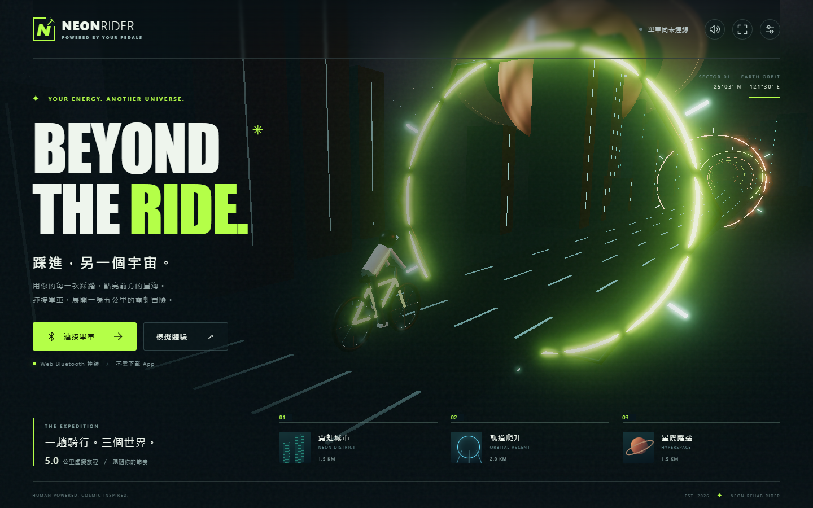
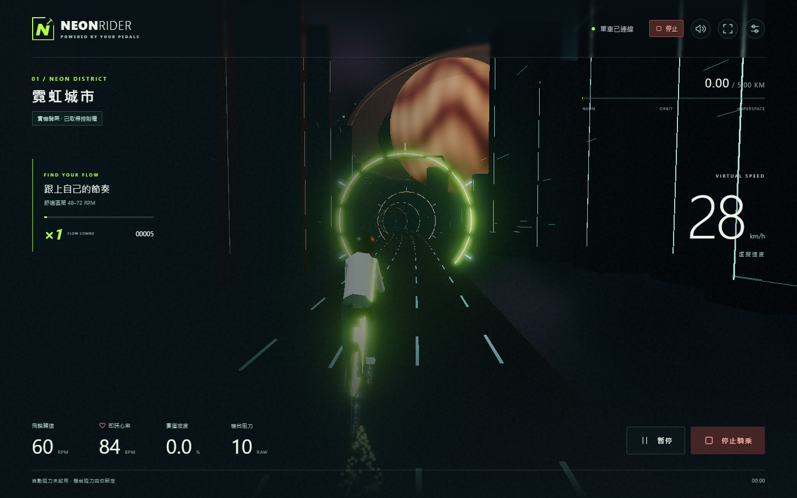

# NEON REHAB RIDER｜星際單車

踩進另一個宇宙。以飛輪 RPM 驅動第三人稱 3D 單車，從霓虹城市、軌道爬升到星際躍遷，完成五公里虛擬旅程。Web Bluetooth 直接連接 [Rehab ESP32 WebBLE](https://github.com/root50643/rehab_esp32_webble)，可依賽道坡度調整已校正的機台阻力。

這是獨立的靜態網站，不需伺服器、帳號或付費服務。原 ESP32 韌體及測試控制台不受影響。





以上為實際瀏覽器截圖。騎乘畫面的 RPM、心率及阻力來自人工 BLE mock，不是實機量測。

## 本機啟動

使用 Node.js 24 與 pnpm 11.25.0（版本固定於 package.json）。若尚未安裝 pnpm，可用 `npm install -g pnpm@11.25.0`。

```sh
pnpm install --frozen-lockfile
pnpm dev
```

開啟 http://127.0.0.1:5173/，按「模擬體驗」即可遊玩。模擬 RPM 滑桿、坡度測試、模擬斷線均使用人工資料，不接觸藍牙硬體。模擬阻力範圍 5／10／20 只供展示，不是實機建議值。

## 遊戲玩法

- 只需踩踏，自動循線轉彎，沒有換道或閃避操作。
- 0–1.5 km 霓虹城市；1.5–3.5 km 軌道爬升；3.5–5 km 星際躍遷。
- 預設舒適轉速 60 RPM，可手動設定或採用 15 秒非零回報中位數。飛輪轉速不一定等於踏板轉速。
- 舒適轉速對應虛擬時速 30 km/h，上限 60 km/h；停踩立即停止遊戲前進。只有有效、非零 RPM 才累積里程與踩踏時間。
- 維持舒適轉速的 80–120%，每 5 秒提升一層連擊，最高 ×5；超出區間 2 秒重設。穩定踩踏每秒獲得 `10 × 連擊` 分並充能，滿能量觸發粒子光效，不增加實體負載。
- 心率只供即時查看。速度、里程與分數皆為遊戲數值；不推測機台功率、距離或熱量原始值的單位。
- 上方工具列可切換音效、全螢幕、畫質與減少動態效果。首次音效需使用者操作才能播放。

## 實機連線

1. 將 ESP32 燒錄為相容的 WebBLE v1 韌體，並完成原專案的接線及機台驗收。
2. 使用 Windows／macOS Chrome 或 Edge、Android Chrome；需 HTTPS 或 localhost。以 `navigator.bluetooth` 功能偵測為準。Safari／Firefox 不提供本遊戲使用的原生 Web Bluetooth 連線，可使用模擬模式。
3. 按「連接單車」，選擇廣播服務相符的 `RehabWebBLE`。
4. 連接後先是唯讀；按「開始騎乘」才取得 30 秒控制租約並啟動機台，持有期間每 10 秒續租。
5. 若其他頁面持有控制權，可由機台啟動後選擇「唯讀騎行」。此模式不會送出啟停與阻力命令。
6. 心率感測器配對／掃描與卡片維護仍使用原專案控制台；遊戲不保存 RFID 或心率歷史。

Web Bluetooth 的 HTTPS、使用者點擊與平台條件見 [Chrome 官方文件](https://developer.chrome.com/docs/capabilities/bluetooth)。

## 機台阻力設定

在設定中填入已確認可用的「輕阻力、平路阻力、重阻力」原始整數與「每次最大幅度」。四欄需全部有效，平路必須位於輕、重之間；可支援數字越大越重或越小越重。四欄皆留空可停用。

**本專案不預設實機阻力範圍。** 1–65535 是協定可編碼範圍，不代表機台或使用者可用範圍。原協定的 0 只取消尚未送出的阻力目標，不代表實際降至零。

每次騎乘需明確勾選自動阻力，設定不會自動啟用。−6% 至 0% 在輕與平路之間插值，0% 至 +8% 在平路與重之間插值。每秒至多一筆，單次調整不超過設定幅度；不堆積過時坡度。

介面分別顯示目標、已送與機台回報。GATT／JSON `ok` 只表示命令接受；控制器還需確認新的 `sent_level`、ACK 等待結束和後續匹配的 `reported_level`，才進行下一次調整。5 秒內未確認或 UART timeout 計數增加即暫停。

## 暫停與斷線

- RPM 與阻力各自依其回報年齡加上本機經過時間，5 秒失效；心率 10 秒失效。有效的 0 與缺失值不同。
- 受控模式遙測／租約失效、調阻失敗、切至背景或 WebGL context 遺失時暫停，嘗試停止並釋放控制權。
- 暫停／結束使用 `stop`，不使用只有確認語意的 `pause`。停止會取消未送出的 Start／阻力，等正在寫入的完整分片訊息結束後優先送出。
- GATT 寫入中斷或分片期限失效時直接斷線，不在不確定的分片串流後追加命令。
- 重新連線不重送舊指令、不自動開始；玩家需再次確認。關頁寫入無法保證完成，韌體既有斷線及租約失效停止機制仍是必要條件。
- 網頁的停止按鈕不是實體急停裝置；實際停止行為以機台與韌體量測為準。

## 檢查與建置

```sh
pnpm typecheck
pnpm test
pnpm build
pnpm exec playwright install chromium
pnpm test:browser
pnpm preview
```

`pnpm build` 產出 `dist/`。`pnpm test:browser` 使用此建置，在 `/rehab_neon_rider/` 子路徑執行瀏覽器測試。若使用本機既有 Chromium／Edge，可設定 `CHROMIUM_PATH` 為其執行檔絕對路徑。

```powershell
$env:CHROMIUM_PATH = 'C:\Program Files (x86)\Microsoft\Edge\Application\msedge.exe'
pnpm test:browser
```

瀏覽器測試包含人工 BLE、模擬玩法、停止／斷線／重連、設定、390／768／1440px 版面，以及正式資源路徑。截圖與失敗 trace 寫入忽略的 `test-results/`。

## GitHub Pages

1. 在 GitHub 建立自己的 `rehab_neon_rider` repository，將本目錄的內容放在 repository 根目錄，推送到 `main`。
2. Settings → Pages → Build and deployment → Source 選 **GitHub Actions**。
3. `Deploy GitHub Pages` workflow 會安裝鎖定依賴、執行單元測試、型別檢查、建置與瀏覽器測試；全部成功後部署 `dist/`。
4. 網址格式為 `https://<帳號>.github.io/<repository>/`。`base: './'` 搭配單頁、相對資源路徑，因此改 repository 名稱也不需改寫資源 URL。

不需任何 API token 放進前端。部署 workflow 使用 GitHub 提供的 Pages 權限。公開程式庫為 [root50643/rehab_neon_rider](https://github.com/root50643/rehab_neon_rider)，檢查與部署結果可在 [GitHub Actions](https://github.com/root50643/rehab_neon_rider/actions) 查看。

若手動上傳靜態主機，只上傳 `dist/` 的內容，保留 assets 子目錄；不要以 `file://` 直接開啟。

## 架構與資料

| 層 | 責任 |
|---|---|
| `src/vendor/protocol.js` | 固定版本的 WebBLE v1 UUID、JSON 分片與命令格式 |
| `src/ble.ts`、`src/simulator.ts` | 相同 Source 介面、連線／通知／命令與人工資料 |
| `src/types.ts` | 遙測正規化與時效判斷，入口即丟棄 RFID |
| `src/ride.ts` | 五公里賽道、坡度、RPM 速度、連擊與結算 |
| `src/resistance.ts` | 坡度映射、幅度與頻率限制、回報確認 |
| `src/scene.ts` | 程序化幾何、騎士、行星、粒子、光暈與畫質 |
| `src/main.ts` | 操作流程與騎乘狀態協調 |
| `src/storage.ts` | 本機設定與最近 20 次成績，不含心率／卡片資料 |

本機儲存不可用時，當次騎乘仍可繼續；紀錄不會同步到其他瀏覽器。畫質以桌機 1080p 60 FPS 為目標，實際效能取決於 GPU；自動模式會降低解析度、星點與後處理負載。手機主要供體驗，Android 的實機連線需另驗。

驗證紀錄與實機檢查表見 [docs/VALIDATION.md](docs/VALIDATION.md)。來源與依賴授權說明見 [THIRD_PARTY_NOTICES.md](THIRD_PARTY_NOTICES.md)。
